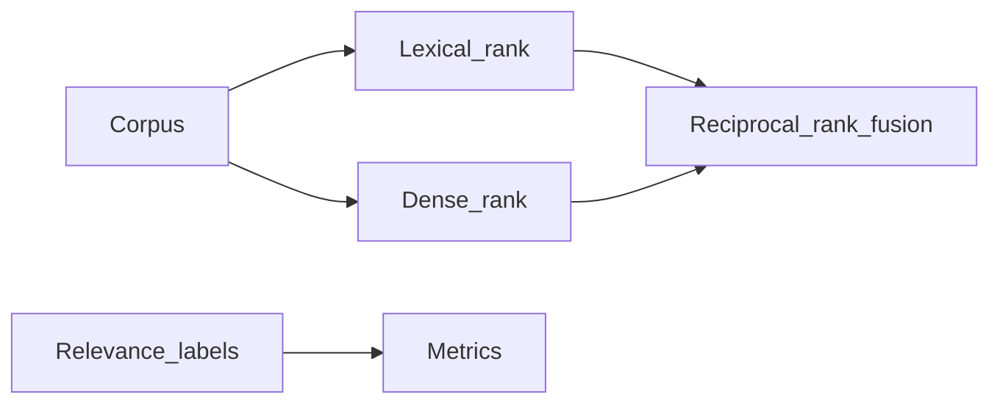

# RAG Retrieval Lab

Lexical, dense and hybrid retrieval on a labeled English corpus.

[](https://github.com/danielpdev/rag-retrieval-lab/actions/workflows/ci.yml)

**Role focus:** RAG / Search / Evaluation. **Status:** working local portfolio implementation, with synthetic data.

## The engineering decision

The same English relevance labels evaluate lexical overlap, MiniLM dense retrieval and reciprocal-rank fusion. Ranking failures are retained alongside Recall@5 and MRR.



## Run locally

Requirements: Python 3.12, [uv](https://docs.astral.sh/uv/getting-started/installation/) and Make.

```bash
git clone https://github.com/danielpdev/rag-retrieval-lab.git
cd rag-retrieval-lab
make setup
make demo
make test
make eval
```

`make demo` uses an isolated temporary database where relevant, so it is safe to repeat. `make eval` writes a timestamped report to `reports/evaluation-fixture.json`. Fixture mode is deterministic and does not represent model inference. There is no recurring hosting or API subscription cost.

This is a CLI project; `make demo` and `make eval` are its entry points.

`make eval-local` installs the optional model extra and runs real MiniLM dense and hybrid retrieval. Initial model download requires internet; inference is local.

[Watch the recorded demo](docs/demo.mp4) · [Reproduce the walkthrough](docs/DEMO.md)

## Verification and evidence

Exact metric calculation on an intentional miss and second-rank hit, deterministic ties and required relevance labels. Local evaluation executes real embeddings.

- [Evaluation report](reports/evaluation-fixture.json) — measured during an actual run; inspect the mode and dataset size.
- [Development and authorship](docs/DEVELOPMENT.md).
- [Romanian interview preparation](docs/INTERVIEW_RO.md).
- [Design notes](docs/DESIGN.md).
- [Demo walkthrough](docs/DEMO.md).

CI uses standard GitHub-hosted runners and deterministic tests without downloading LLM weights. The lockfiles record exact package versions. Local-model results, when present, live in `reports/evaluation-local.json`; hardware/model identities are in `reports/environment.json`.

## Limits and next iteration

Six documents and six queries are deliberately small. Dense retrieval loads a model only in local mode. The shared ranker conventions also appear in Support RAG Desk; this repository isolates retrieval experiments.

Next: Add realistic distractors, chunking experiments and held-out multilingual relevance labels.

The local demonstration does not include production authentication, secret management or operational service guarantees. Bind it to localhost and use synthetic data. These projects demonstrate engineering decisions; they do not claim real customers, paid production deployments or guaranteed interviews.

## Project ownership

Implemented with Codex assistance for Daniel Popa. The owner should review the code, run it, make an independent change and rehearse the tradeoffs before presenting it at interview. That human understanding check is pending and cannot be verified automatically. See [development notes](docs/DEVELOPMENT.md).

MIT for original source; dependencies/models retain their own licenses. See [third-party notices](THIRD_PARTY.md).
